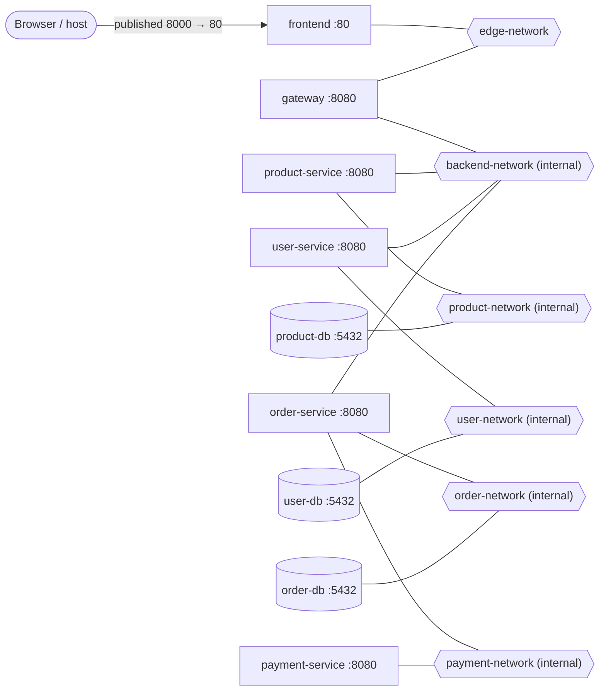
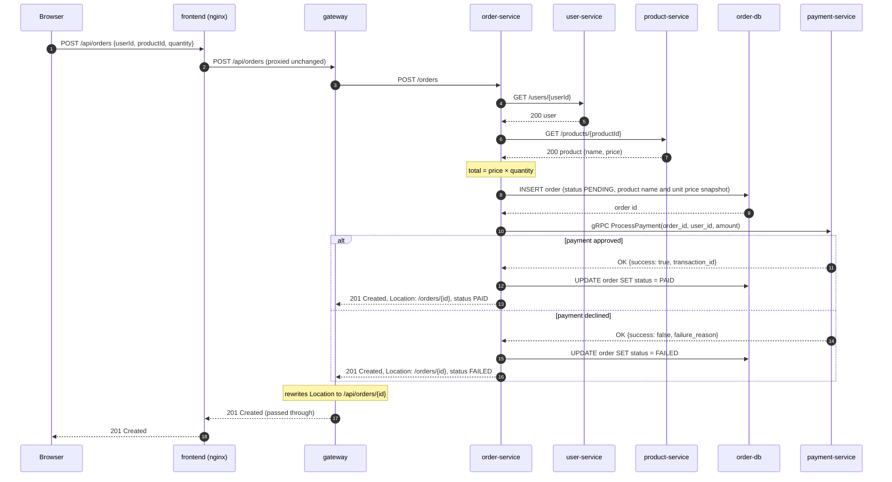

# TinyShop architecture

## 1. Overview

TinyShop is a small e-commerce system: a React frontend, an API gateway, four .NET services and three PostgreSQL databases, all running in Docker Compose. This document describes the **physical** architecture: containers, ports, networks, and how a request travels through them. Endpoint behaviour is specified in [contracts.md](contracts.md).

Design principles:

- **Only the frontend is reachable from the host.** The browser talks to nginx, and nginx proxies `/api` to the gateway, so everything is served from one origin and no CORS is needed.
- **Each database belongs to one service, and the network enforces it.** A database shares an internal network with its owning service and nothing else.
- **Internal by default.** Every network except the edge network is `internal: true`: no traffic to or from anything outside Docker, and published ports are ignored.
- **Standard ports inside containers, distinct ports on the host.** Isolation lets every container use its image's conventional port. Everything published on, or run directly on, the host gets a unique port that is deliberately different from the container port.

### Repository layout

```text
tinyshop/
├── TinyShop.slnx
├── src/                          application code: one folder per container image
│   ├── product-service/
│   │   ├── Dockerfile            each image's Dockerfile sits next to the code it builds
│   │   └── ...
│   ├── user-service/
│   ├── order-service/
│   ├── payment-service/
│   ├── gateway/
│   └── frontend/                 React app, plus its Dockerfile and nginx config (baked into the image)
├── tests/                        test projects, one per service
├── proto/                        protobuf contracts (buf module root)
├── docs/                         this document, contracts.md, ...
└── infrastructure/               everything that runs the system but isn't application code
    ├── compose/
    │   ├── compose.yaml          the single Compose file for the whole system
    │   ├── .env.example          committed template of every variable
    │   └── .env                  your values (git-ignored)
    ├── postgres/                 database configuration or init scripts, if ever needed
    ├── load/                     k6 load-test scripts (TS-017)
    ├── scripts/                  helper scripts, such as the reachability check (TS-014)
    └── observability/            collector, Prometheus, Loki, Tempo, Grafana config (later epics)
```

Rules:

- **A file that's baked into an image lives with that image's code.** A file that's mounted into a container at run time, or that drives the system from outside, lives under `infrastructure/`. So nginx's config is in `src/frontend/`, while a Grafana dashboard mounted into the stock Grafana image belongs in `infrastructure/observability/`.
- **Folders are created when their first file arrives,** not in advance. The tree above shows where things will go, not what exists today.

#### Working with Compose from `infrastructure/compose/`

Compose treats the folder containing `compose.yaml` as the **project directory**, which has three consequences:

- **`.env` is read from `infrastructure/compose/`,** next to `compose.yaml`, not from `tinyshop/`.
- **Relative paths inside `compose.yaml` are resolved from `infrastructure/compose/`.** A service's build context is therefore `../..` (that is, `tinyshop/`), with `dockerfile: src/<service>/Dockerfile`.
- **The project name would default to the folder name, `compose`.** `compose.yaml` sets `name: tinyshop` at the top so that containers, networks and volumes are named `tinyshop-…` / `tinyshop_…` as this document assumes.

Every `docker compose` command in the tickets and documents is run from `tinyshop/infrastructure/compose/`. From anywhere else, add `-f <path>/compose.yaml`.

## 2. Container inventory

| Service (DNS name) | Image / build | Role | Container port | Host port | Networks |
|---|---|---|---|---|---|
| `frontend` | build `tinyshop/src/frontend` (Node build stage → nginx) | Serves the React SPA, reverse-proxies `/api/*` to `gateway` | 80 (HTTP/1.1) | **8000** | `edge-network` |
| `gateway` | build `tinyshop/src/gateway` (`mcr.microsoft.com/dotnet/aspnet:10.0`) | Public API (`/api/*`), forwards to internal services | 8080 (HTTP/1.1) | none | `edge-network`, `backend-network` |
| `product-service` | build `tinyshop/src/product-service` | Product catalogue | 8080 (HTTP/1.1) | none | `backend-network`, `product-network` |
| `user-service` | build `tinyshop/src/user-service` | User lookup | 8080 (HTTP/1.1) | none | `backend-network`, `user-network` |
| `order-service` | build `tinyshop/src/order-service` | Order creation and lookup, orchestrates the order flow | 8080 (HTTP/1.1) | none | `backend-network`, `order-network`, `payment-network` |
| `payment-service` | build `tinyshop/src/payment-service` | Simulated payment processing (gRPC) | 8080 (HTTP/2 only, h2c) | none | `payment-network` |
| `product-db` | `postgres:18-alpine` | Database `tinyshop_products` | 5432 | none | `product-network` |
| `user-db` | `postgres:18-alpine` | Database `tinyshop_users` | 5432 | none | `user-network` |
| `order-db` | `postgres:18-alpine` | Database `tinyshop_orders` | 5432 | none | `order-network` |

Debug-only containers, started only with `docker compose --profile debug` (see [§8](#8-local-development)):

| Service (DNS name) | Image | Role | Container port | Host port | Networks |
|---|---|---|---|---|---|
| `product-db-proxy` | `alpine/socat` | Forwards host connections to `product-db:5432` | 5432 | **127.0.0.1:5433** | `debug-network`, `product-network` |
| `user-db-proxy` | `alpine/socat` | Forwards host connections to `user-db:5432` | 5432 | **127.0.0.1:5434** | `debug-network`, `user-network` |
| `order-db-proxy` | `alpine/socat` | Forwards host connections to `order-db:5432` | 5432 | **127.0.0.1:5435** | `debug-network`, `order-network` |

Notes:

- **Published ports bind to every host interface by default.** `"8000:80"` is reachable at `localhost:8000` and also from any machine that can reach the host's LAN IP. That's intended for `frontend`. The debug proxies must never be exposed like that, so they bind to the loopback interface only (`"127.0.0.1:5433:5432"`).

- **8080** is the default port of .NET 8+ container images, so the services need no port configuration inside Docker. A non-privileged port also lets the services run as a non-root user.
- **Payment's port 8080 speaks only HTTP/2.** gRPC requires HTTP/2, and without TLS a client can't negotiate the protocol, so the port is configured for HTTP/2 only (h2c).
- **The three databases all listen on 5432 without conflict.** Each container has its own network namespace, so ports only collide when they are published on the same host.
- **Image tags are pinned to a major version** (`postgres:18-alpine`, `aspnet:10.0`) so a rebuild never silently moves to a new major version. Exact patch or digest pinning is an open question ([§9](#9-open-questions)).
- **The Postgres 18 image changed its data directory.** Mount volumes at `/var/lib/postgresql`, not `/var/lib/postgresql/data` as in older guides.

## 3. Networks

| Network | Internal | Members | Purpose |
|---|---|---|---|
| `edge-network` | no | `frontend`, `gateway` | The only network reachable from the host. Carries browser traffic in through the published frontend port, and nginx → gateway. |
| `backend-network` | yes | `gateway`, `product-service`, `user-service`, `order-service` | Service-to-service HTTP calls. |
| `product-network` | yes | `product-service`, `product-db` | Product service ↔ its database only. |
| `user-network` | yes | `user-service`, `user-db` | User service ↔ its database only. |
| `order-network` | yes | `order-service`, `order-db` | Order service ↔ its database only. |
| `payment-network` | yes | `order-service`, `payment-service` | Order → Payment gRPC. Keeps Payment unreachable from the gateway and the other services. |
| `debug-network` | no | the `*-db-proxy` containers | Debug profile only. Gives host tools a way into the database networks. |

Compose prefixes network names with the project name, so `docker network ls` shows them as `tinyshop_backend-network` and so on.

### Deliberate trade-offs

- **`backend-network` is a flat trust zone.** Docker networks have no direction and no per-pair rules: every member can reach every other member. The connections actually used are gateway → product/user/order and order → product/user. The others (for example product → user, or any service → gateway) are reachable but unused. Splitting the network into one per pair would remove them, at the cost of many more networks. Finer-grained control belongs at a higher layer, such as mutual TLS and authorization (epic M1.5).
- **Egress (outbound internet).** `frontend` and `gateway` have internet access because `edge-network` isn't internal. The database proxies have it through `debug-network` while the debug profile runs. Every other container has no route outside Docker. Nothing in TinyShop calls the internet, so this is acceptable, but it isn't zero.

## 4. Reachability matrix

Can the row open a TCP connection to the column? This shows the default stack, without the debug profile.

Legend: ✓ allowed and used · ◐ reachable but unused (shared network) · ✗ blocked by the network design · – self

| From \ To | frontend | gateway | product-service | user-service | order-service | payment-service | product-db | user-db | order-db |
|---|---|---|---|---|---|---|---|---|---|
| **browser (host)** | ✓ (via :8000) | ✗ | ✗ | ✗ | ✗ | ✗ | ✗ | ✗ | ✗ |
| **frontend** | – | ✓ | ✗ | ✗ | ✗ | ✗ | ✗ | ✗ | ✗ |
| **gateway** | ◐ | – | ✓ | ✓ | ✓ | ✗ | ✗ | ✗ | ✗ |
| **product-service** | ✗ | ◐ | – | ◐ | ◐ | ✗ | ✓ | ✗ | ✗ |
| **user-service** | ✗ | ◐ | ◐ | – | ◐ | ✗ | ✗ | ✓ | ✗ |
| **order-service** | ✗ | ◐ | ✓ | ✓ | – | ✓ | ✗ | ✗ | ✓ |
| **payment-service** | ✗ | ✗ | ✗ | ✗ | ◐ | – | ✗ | ✗ | ✗ |

The databases never initiate connections, so they have no rows. Things to check:

- The gateway can reach no database, and can't reach `payment-service`.
- `order-service` can't reach `user-db` or `product-db`. It must go through the owning service.
- The browser reaches nothing except the frontend's published port.

## 5. Component diagrams

The network topology and the call graph are shown as two diagrams. A Mermaid node can only sit inside one subgraph, and most TinyShop containers are on two or three networks, so a single diagram would misrepresent either the networks or the calls.

### 5.1 Network topology

Hexagons are networks; a line means "attached to".



### 5.2 Calls and protocols


## 6. Request flow: `POST /api/orders`



The other outcomes (unknown user or product, dependency failures, timeouts) are specified in the dependency-failure translation table in [contracts.md](contracts.md).

## 7. Naming conventions

| Thing | Convention | Examples |
|---|---|---|
| Compose services (= container DNS names) | `<name>-service` for .NET services, `<name>-db` for databases, `<name>-db-proxy` for debug proxies. `frontend` and `gateway` are single words. | `product-service`, `product-db`, `product-db-proxy` |
| Networks | `<purpose>-network` | `edge-network`, `backend-network`, `product-network` |
| Volumes | `<container>-data` | `product-db-data` |
| Databases | `tinyshop_<plural>` | `tinyshop_products`, `tinyshop_users`, `tinyshop_orders` |
| Compose profiles | lowercase word | `debug` |

### Environment variables

- **.NET configuration** is read from environment variables, with a double underscore (`__`) standing for the `:` that separates configuration sections:
  - Connection strings: `ConnectionStrings__<Name>Db`, read with `GetConnectionString("<Name>Db")`. Example: `ConnectionStrings__ProductDb`.
  - Addresses of other services: `Services__<Name>Service__BaseUrl`, bound to `Services:<Name>Service:BaseUrl`. Example: `Services__ProductService__BaseUrl=http://product-service:8080`.
  - Listening port: `ASPNETCORE_HTTP_PORTS` (left at the image default of 8080 in containers).
- **Postgres images** use the image's own variables: `POSTGRES_DB`, `POSTGRES_USER`, `POSTGRES_PASSWORD`.
- **Compose-level variables** (from `infrastructure/compose/.env`, used for substitution inside `compose.yaml`) are `UPPER_SNAKE_CASE`, prefixed with the container they belong to. Examples: `PRODUCT_DB_PASSWORD`, `FRONTEND_HOST_PORT`. `.env` is git-ignored, and `.env.example` documents every variable.

## 8. Local development

### The problem

During step 1, `product-service` runs on the host with `dotnet run` while `product-db` runs in Docker. Other tools on the host need the same access at other times: `dotnet ef database update`, a database GUI or `psql` on Windows, or debugging one service in the IDE while the rest of the system runs in Docker.

`product-db` is attached only to `product-network`, which is internal. Docker ignores published ports on internal networks, so the database can't be reached from the host at all.

### The solution: a forwarding container behind a profile

```text
host process ──localhost:5433──► product-db-proxy ──product-db:5432──► product-db
                                 (debug-network + product-network)    (product-network only)
```

`product-db-proxy` runs `socat`. It publishes host port 5433 through the non-internal `debug-network`. For every connection it accepts, it opens a **second** TCP connection to `product-db:5432` over `product-network` and copies bytes in both directions. As a consequence, Postgres sees the proxy's IP as the client address, not the host's.

The proxies belong to the `debug` profile. `docker compose up` doesn't start them; `docker compose --profile debug up` does. That's why they don't conflict with "only the frontend publishes a port": in the default stack, the only published port is 8000.

The proxies publish on **`127.0.0.1` only** (`"127.0.0.1:5433:5432"`), never on all interfaces. A plain `"5433:5432"` would bind to every network interface on the host, so anyone on the same Wi-Fi or LAN could connect straight to the database. Binding to loopback means only processes on this machine can use the entry point.

### Alternatives considered

- **Attach `product-db` to an extra, non-internal network and publish its port** (in an override file). Rejected: the database's own network setup would differ between development and the normal stack, and the database would gain internet access.
- **Set `internal: false` on `product-network` in development.** Rejected for the same reason, and it's the weakest option: it removes the isolation instead of adding a controlled entry point.

The chosen approach is the same idea as a bastion host or `kubectl port-forward`.

### Host ports used in development

| What | Runs on the host at | Reaches its dependencies at |
|---|---|---|
| `gateway` (`dotnet run`) | `http://localhost:5100` | the other services' `dotnet run` ports below |
| `product-service` (`dotnet run`) | `http://localhost:5101` | `localhost:5433` (`product-db-proxy`) |
| `user-service` (`dotnet run`) | `http://localhost:5102` | `localhost:5434` (`user-db-proxy`) |
| `order-service` (`dotnet run`) | `http://localhost:5103` | `localhost:5435` (`order-db-proxy`), and the other services' `dotnet run` ports |
| `payment-service` (`dotnet run`) | `http://localhost:5104` (HTTP/2) | none |
| frontend (Vite dev server) | `http://localhost:5173` | proxies `/api` to the gateway |
| `frontend` (container) | `http://localhost:8000` | `gateway:8080` |

So moving a service from the host into Docker changes both where it listens and where it connects. For example, product-service:

| | Listens on | Connects to the database at |
|---|---|---|
| Host (step 1) | `localhost:5101` | `Host=localhost;Port=5433` |
| Docker (step 2) | `8080` | `Host=product-db;Port=5432` |

The same database, reached by a different path, needs a different address. The port numbers are configuration, not code.

## 9. Open questions

| # | Question | Decide in |
|---|---|---|
| Q1 | How does Docker health-check `payment-service`, given its port speaks only HTTP/2? Options: the standard gRPC health protocol (`grpc.health.v1`) with a probe tool, or a second HTTP/1.1 port for `/health`. | Step 4 |
| Q2 | Image pinning: major tag (current), exact patch tag, or digest? | Step 2 |
| Q3 | Run nginx as non-root (the unprivileged image listens on 8080 instead of 80)? | Step 7 |
| Q4 | Startup order: `depends_on` with `condition: service_healthy` for each service–database pair, plus whether services should also retry their first database connection. | Step 2 |
| Q5 | Does `nginx` strip the `/api` prefix, or does the gateway own `/api/*`? (Assumed in this document: the gateway owns `/api/*` and nginx forwards the path unchanged.) | Step 6/7 |
