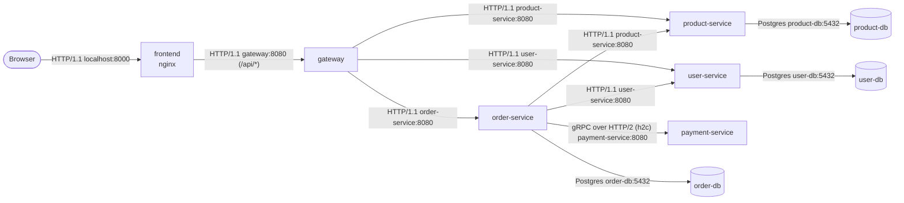
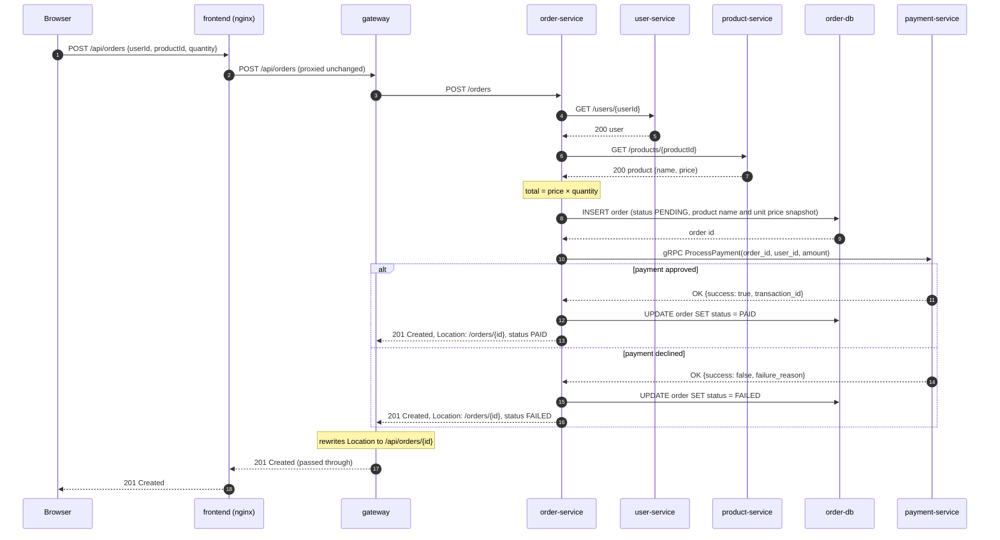

# TinyShop architecture

## 1. Overview

TinyShop is a small e-commerce system: a React frontend, an API gateway, four .NET services and three PostgreSQL databases, all running in Docker Compose. This document describes the **physical** architecture: containers, ports, networks, and how a request travels through them. Endpoint behaviour is specified in [contracts.md](contracts.md).

Design principles:

- **Only the frontend is reachable from the host.** The browser talks to nginx, and nginx proxies `/api` to the gateway, so everything is served from one origin and no CORS is needed.
- **Each database belongs to one service, and the network enforces it.** A database shares an internal network with its owning service and nothing else.
- **Internal by default.** Every network except the edge network is `internal: true`: no traffic to or from anything outside Docker, and published ports are ignored.
- **Standard ports inside containers, distinct ports on the host.** Isolation lets every container use its image's conventional port. Everything published on, or run directly on, the host gets a unique port that is deliberately different from the container port.

### Repository layout

```text
tinyshop/
├── global.json                   pins the .NET SDK version (local and CI)
├── Directory.Build.props         build settings shared by every project
├── Directory.Packages.props      every NuGet package version, set once
├── .editorconfig                 formatting and code-style rules
├── services/                     one self-contained folder per service (= per container image)
│   ├── product-service/
│   │   ├── TinyShop.ProductService.slnx                the service's own solution
│   │   ├── Dockerfile                                  next to the code it builds
│   │   ├── src/
│   │   │   ├── TinyShop.ProductService.Api/            controllers, error handling, composition root
│   │   │   ├── TinyShop.ProductService.Application/    use cases, models, interfaces
│   │   │   ├── TinyShop.ProductService.Domain/         entities, enums
│   │   │   └── TinyShop.ProductService.Infrastructure/ EF Core, migrations, repositories, health checks
│   │   └── tests/
│   │       ├── TinyShop.ProductService.UnitTests/
│   │       └── TinyShop.ProductService.IntegrationTests/  (TS-009)
│   ├── user-service/             same shape
│   ├── order-service/
│   ├── payment-service/
│   ├── gateway/
│   └── frontend/                 React app, plus its Dockerfile and nginx config (baked into the image)
├── shared/                       plumbing every .NET service uses the same way (D25, TS-024; rules in its README)
│   ├── TinyShop.Shared.slnx      builds and tests everything in shared/ (CI job "dotnet (shared)")
│   ├── TinyShop.ServiceDefaults/ web plumbing (AddServiceDefaults/UseServiceDefaults); referenced by Api projects only
│   ├── TinyShop.ServiceDefaults.Data/          database plumbing (Npgsql); Infrastructure projects only
│   ├── TinyShop.ServiceDefaults.Abstractions/  dependency-free types (DataStoreUnavailableException); any layer
│   ├── TinyShop.Testing/         test support (assertions, Postgres fixture base); test projects only
│   └── tests/                    unit tests for the shared code
├── proto/                        protobuf contracts (buf module root)
├── docs/                         this document, contracts.md, ...
└── infrastructure/               everything that runs the system but isn't application code
    ├── compose/
    │   ├── compose.yaml          the single Compose file for the whole system
    │   ├── .env.example          committed template of every variable
    │   └── .env                  your values (git-ignored)
    ├── postgres/initdb/          init scripts mounted into every service database (role setup, §10)
    ├── load/                     k6 load-test scripts (TS-017)
    ├── scripts/                  helper scripts, such as the reachability check (TS-014)
    └── observability/            collector, Prometheus, Loki, Tempo, Grafana config (later epics)
```

Rules:

- **Each service is one self-contained folder:** its solution, Dockerfile, code (`src/`) and tests (`tests/`). A service's projects may reference only projects inside its own folder and in `shared/`; services depend on each other through contracts (`proto/`, contracts.md), never through code. CI enforces this with `infrastructure/scripts/check-service-boundaries.sh`.
- **Shared code is plumbing only** (decision D25): `shared/` holds technical concerns that are the same in every service (error responses, health endpoints, test support), never domain types, DTOs, service-specific error codes or clients for other services. A `shared/` project may never reference a service. See `shared/README.md`.
- **Files shared by all .NET services stay at `tinyshop/`** (`global.json`, `Directory.*.props`, `.editorconfig`). MSBuild and the SDK find them by searching upward from each project, so they apply to every service without being referenced.
- **A file that's baked into an image lives with that image's code.** A file that's mounted into a container at run time, or that drives the system from outside, lives under `infrastructure/`. So nginx's config is in `services/frontend/`, while a Grafana dashboard mounted into the stock Grafana image belongs in `infrastructure/observability/`.
- **Folders are created when their first file arrives,** not in advance. The tree above shows where things will go, not what exists today.

#### Working with Compose from `infrastructure/compose/`

Compose treats the folder containing `compose.yaml` as the **project directory**, which has three consequences:

- **`.env` is read from `infrastructure/compose/`,** next to `compose.yaml`, not from `tinyshop/`.
- **Relative paths inside `compose.yaml` are resolved from `infrastructure/compose/`.** A service's build context is therefore `../..` (that is, `tinyshop/`), with `dockerfile: services/<service>/Dockerfile`. The context must be `tinyshop/`, not the service folder: the build needs `Directory.Packages.props` (every package version), `global.json`, `Directory.Build.props` and, for gRPC services, `proto/`.
- **The project name would default to the folder name, `compose`.** `compose.yaml` sets `name: tinyshop` at the top so that containers, networks and volumes are named `tinyshop-…` / `tinyshop_…` as this document assumes.

Every `docker compose` command in the tickets and documents is run from `tinyshop/infrastructure/compose/`. From anywhere else, add `-f <path>/compose.yaml`.

## 2. Container inventory

| Service (DNS name) | Image / build | Role | Container port | Host port | Networks |
|---|---|---|---|---|---|
| `frontend` | build `tinyshop/services/frontend` (Node build stage → nginx) | Serves the React SPA, reverse-proxies `/api/*` to `gateway` | 80 (HTTP/1.1) | **8000** | `edge-network` |
| `gateway` | build `tinyshop/services/gateway` (`mcr.microsoft.com/dotnet/aspnet:10.0`) | Public API (`/api/*`), forwards to internal services | 8080 (HTTP/1.1) | none | `edge-network`, `backend-network` |
| `product-service` | build `tinyshop/services/product-service` (runtime `mcr.microsoft.com/dotnet/aspnet:10.0-alpine`) | Product catalogue | 8080 (HTTP/1.1) | none | `backend-network`, `product-network` |
| `user-service` | build `tinyshop/services/user-service` (runtime `mcr.microsoft.com/dotnet/aspnet:10.0-alpine`) | User lookup | 8080 (HTTP/1.1) | none | `backend-network`, `user-network` |
| `order-service` | build `tinyshop/services/order-service` | Order creation and lookup, orchestrates the order flow | 8080 (HTTP/1.1) | none | `backend-network`, `order-network`, `payment-network` |
| `payment-service` | build `tinyshop/services/payment-service` (runtime `mcr.microsoft.com/dotnet/aspnet:10.0-alpine`, plus `grpc_health_probe`) | Simulated payment processing (gRPC) | 8080 (HTTP/2 only, h2c) | none | `payment-network` |
| `product-db` | `postgres:18-alpine` | Database `tinyshop_products` | 5432 | none | `product-network` |
| `user-db` | `postgres:18-alpine` | Database `tinyshop_users` | 5432 | none | `user-network` |
| `order-db` | `postgres:18-alpine` | Database `tinyshop_orders` | 5432 | none | `order-network` |

One-off jobs: they run to completion during startup, then stay stopped (see [§10](#10-startup-migrations-and-health-checks)):

| Service (DNS name) | Image | Role | Container port | Host port | Networks |
|---|---|---|---|---|---|
| `product-db-migrate` | build `tinyshop/services/product-service`, target `migrations` (`aspnet:10.0`) | Applies product-service's EF Core migrations, then exits | none | none | `product-network` |
| `user-db-migrate` | build `tinyshop/services/user-service`, target `migrations` (`aspnet:10.0`) | Applies user-service's EF Core migrations, then exits | none | none | `user-network` |

Debug-only containers, started only with `docker compose --profile debug` (see [§8](#8-local-development)):

| Service (DNS name) | Image | Role | Container port | Host port | Networks |
|---|---|---|---|---|---|
| `product-db-proxy` | `alpine/socat` | Forwards host connections to `product-db:5432` | 5432 | **127.0.0.1:5433** | `debug-network`, `product-network` |
| `user-db-proxy` | `alpine/socat` | Forwards host connections to `user-db:5432` | 5432 | **127.0.0.1:5434** | `debug-network`, `user-network` |
| `order-db-proxy` | `alpine/socat` | Forwards host connections to `order-db:5432` | 5432 | **127.0.0.1:5435** | `debug-network`, `order-network` |

Notes:

- **Published ports bind to every host interface by default.** `"8000:80"` is reachable at `localhost:8000` and also from any machine that can reach the host's LAN IP. That's intended for `frontend`. The debug proxies must never be exposed like that, so they bind to the loopback interface only (`"127.0.0.1:5433:5432"`).

- **8080** is the default port of .NET 8+ container images, so the services need no port configuration inside Docker. A non-privileged port also lets the services run as a non-root user.
- **Payment's port 8080 speaks only HTTP/2.** gRPC requires HTTP/2, and without TLS a client can't negotiate the protocol, so the port is configured for HTTP/2 only (h2c).
- **The three databases all listen on 5432 without conflict.** Each container has its own network namespace, so ports only collide when they are published on the same host.
- **Image pinning (Q2, decided in TS-010):**

  | Image kind | Pinned to | Example | Why |
  |---|---|---|---|
  | Official, actively maintained base images | Major version | `postgres:18-alpine`, `sdk:10.0`, `aspnet:10.0-alpine` | The publisher moves these tags to each new patch release, so a rebuild picks up security fixes automatically, but never a new major version |
  | Small third-party images | Exact version | `alpine/socat:1.8.1.1` | Their tags aren't maintained as rolling major-version tags, so only an exact tag is predictable |
  | GitHub Actions | Commit SHA | `actions/checkout@3d3c42e…` | Actions run code with access to the repository, so a movable tag is a supply-chain risk (TS-006) |

  Digests (`image@sha256:…`) were rejected: they're fully reproducible, but unreadable, and they stop patch releases arriving on their own. Dependabot watches every Dockerfile and `compose.yaml` and opens a pull request when a newer version appears. Note: Docker reuses a cached base image, so a local rebuild only picks up a newer patch release with `docker compose build --pull`.
- **The Postgres 18 image changed its data directory.** Mount volumes at `/var/lib/postgresql`, not `/var/lib/postgresql/data` as in older guides.

## 3. Networks

| Network | Internal | Members | Purpose |
|---|---|---|---|
| `edge-network` | no | `frontend`, `gateway` | The only network reachable from the host. Carries browser traffic in through the published frontend port, and nginx → gateway. |
| `backend-network` | yes | `gateway`, `product-service`, `user-service`, `order-service` | Service-to-service HTTP calls. |
| `product-network` | yes | `product-service`, `product-db` | Product service ↔ its database only. |
| `user-network` | yes | `user-service`, `user-db` | User service ↔ its database only. |
| `order-network` | yes | `order-service`, `order-db` | Order service ↔ its database only. |
| `payment-network` | yes | `order-service`, `payment-service` | Order → Payment gRPC. Keeps Payment unreachable from the gateway and the other services. |
| `debug-network` | no | the `*-db-proxy` containers | Debug profile only. Gives host tools a way into the database networks. |

Compose prefixes network names with the project name, so `docker network ls` shows them as `tinyshop_backend-network` and so on.

### Deliberate trade-offs

- **`backend-network` is a flat trust zone.** Docker networks have no direction and no per-pair rules: every member can reach every other member. The connections actually used are gateway → product/user/order and order → product/user. The others (for example product → user, or any service → gateway) are reachable but unused. Splitting the network into one per pair would remove them, at the cost of many more networks. Finer-grained control belongs at a higher layer, such as mutual TLS and authorization (epic M1.5).
- **Egress (outbound internet).** `frontend` and `gateway` have internet access because `edge-network` isn't internal. The database proxies have it through `debug-network` while the debug profile runs. Every other container has no route outside Docker. Nothing in TinyShop calls the internet, so this is acceptable, but it isn't zero.

## 4. Reachability matrix

Can the row open a TCP connection to the column? This shows the default stack, without the debug profile.

Legend: ✓ allowed and used · ◐ reachable but unused (shared network) · ✗ blocked by the network design · – self

| From \ To | frontend | gateway | product-service | user-service | order-service | payment-service | product-db | user-db | order-db |
|---|---|---|---|---|---|---|---|---|---|
| **browser (host)** | ✓ (via :8000) | ✗ | ✗ | ✗ | ✗ | ✗ | ✗ | ✗ | ✗ |
| **frontend** | – | ✓ | ✗ | ✗ | ✗ | ✗ | ✗ | ✗ | ✗ |
| **gateway** | ◐ | – | ✓ | ✓ | ✓ | ✗ | ✗ | ✗ | ✗ |
| **product-service** | ✗ | ◐ | – | ◐ | ◐ | ✗ | ✓ | ✗ | ✗ |
| **user-service** | ✗ | ◐ | ◐ | – | ◐ | ✗ | ✗ | ✓ | ✗ |
| **order-service** | ✗ | ◐ | ✓ | ✓ | – | ✓ | ✗ | ✗ | ✓ |
| **payment-service** | ✗ | ✗ | ✗ | ✗ | ◐ | – | ✗ | ✗ | ✗ |

The databases never initiate connections, so they have no rows. Things to check:

- The gateway can reach no database, and can't reach `payment-service`.
- `order-service` can't reach `user-db` or `product-db`. It must go through the owning service.
- The browser reaches nothing except the frontend's published port.

## 5. Component diagrams

The network topology and the call graph are shown as two diagrams. A Mermaid node can only sit inside one subgraph, and most TinyShop containers are on two or three networks, so a single diagram would misrepresent either the networks or the calls.

### 5.1 Network topology

Hexagons are networks; a line means "attached to".


### 5.2 Calls and protocols



## 6. Request flow: `POST /api/orders`



The other outcomes (unknown user or product, dependency failures, timeouts) are specified in the dependency-failure translation table in [contracts.md](contracts.md).

## 7. Naming conventions

| Thing | Convention | Examples |
|---|---|---|
| Compose services (= container DNS names) | `<name>-service` for .NET services, `<name>-db` for databases, `<name>-db-proxy` for debug proxies. `frontend` and `gateway` are single words. | `product-service`, `product-db`, `product-db-proxy` |
| Networks | `<purpose>-network` | `edge-network`, `backend-network`, `product-network` |
| Volumes | `<container>-data` | `product-db-data` |
| Databases | `tinyshop_<plural>` | `tinyshop_products`, `tinyshop_users`, `tinyshop_orders` |
| Compose profiles | lowercase word | `debug` |

### Environment variables

- **.NET configuration** is read from environment variables, with a double underscore (`__`) standing for the `:` that separates configuration sections:
  - Connection strings: `ConnectionStrings__<Name>Db`, read with `GetConnectionString("<Name>Db")`. Example: `ConnectionStrings__ProductDb`.
  - Addresses of other services: `Services__<Name>Service__BaseUrl`, bound to `Services:<Name>Service:BaseUrl`. Example: `Services__ProductService__BaseUrl=http://product-service:8080`.
  - Listening port: `ASPNETCORE_HTTP_PORTS` (left at the image default of 8080 in containers).
- **Postgres images** use the image's own variables: `POSTGRES_DB`, `POSTGRES_USER`, `POSTGRES_PASSWORD`.
- **Compose-level variables** (from `infrastructure/compose/.env`, used for substitution inside `compose.yaml`) are `UPPER_SNAKE_CASE`, prefixed with the container they belong to. Examples: `PRODUCT_DB_APP_PASSWORD`, `FRONTEND_HOST_PORT`. `.env` is git-ignored, and `.env.example` documents every variable.

## 8. Local development

### The problem

During step 1, `product-service` runs on the host with `dotnet run` while `product-db` runs in Docker. Other tools on the host need the same access at other times: `dotnet ef database update`, a database GUI or `psql` on Windows, or debugging one service in the IDE while the rest of the system runs in Docker.

`product-db` is attached only to `product-network`, which is internal. Docker ignores published ports on internal networks, so the database can't be reached from the host at all.

### The solution: a forwarding container behind a profile

```text
host process ──localhost:5433──► product-db-proxy ──product-db:5432──► product-db
                                 (debug-network + product-network)    (product-network only)
```

`product-db-proxy` runs `socat`. It publishes host port 5433 through the non-internal `debug-network`. For every connection it accepts, it opens a **second** TCP connection to `product-db:5432` over `product-network` and copies bytes in both directions. As a consequence, Postgres sees the proxy's IP as the client address, not the host's.

The proxies belong to the `debug` profile. `docker compose up` doesn't start them; `docker compose --profile debug up` does. That's why they don't conflict with "only the frontend publishes a port": in the default stack, the only published port is 8000.

The proxies publish on **`127.0.0.1` only** (`"127.0.0.1:5433:5432"`), never on all interfaces. A plain `"5433:5432"` would bind to every network interface on the host, so anyone on the same Wi-Fi or LAN could connect straight to the database. Binding to loopback means only processes on this machine can use the entry point.

### Alternatives considered

- **Attach `product-db` to an extra, non-internal network and publish its port** (in an override file). Rejected: the database's own network setup would differ between development and the normal stack, and the database would gain internet access.
- **Set `internal: false` on `product-network` in development.** Rejected for the same reason, and it's the weakest option: it removes the isolation instead of adding a controlled entry point.

The chosen approach is the same idea as a bastion host or `kubectl port-forward`.

### Host ports used in development

| What | Runs on the host at | Reaches its dependencies at |
|---|---|---|
| `gateway` (`dotnet run`) | `http://localhost:5100` | the other services' `dotnet run` ports below |
| `product-service` (`dotnet run`) | `http://localhost:5101` | `localhost:5433` (`product-db-proxy`) |
| `user-service` (`dotnet run`) | `http://localhost:5102` | `localhost:5434` (`user-db-proxy`) |
| `order-service` (`dotnet run`) | `http://localhost:5103` | `localhost:5435` (`order-db-proxy`), and the other services' `dotnet run` ports |
| `payment-service` (`dotnet run`) | `http://localhost:5104` (HTTP/2) | none |
| frontend (Vite dev server) | `http://localhost:5173` | proxies `/api` to the gateway |
| `frontend` (container) | `http://localhost:8000` | `gateway:8080` |

So moving a service from the host into Docker changes both where it listens and where it connects. For example, product-service:

| | Listens on | Connects to the database at |
|---|---|---|
| Host (step 1) | `localhost:5101` | `Host=localhost;Port=5433` |
| Docker (step 2) | `8080` | `Host=product-db;Port=5432` |

The same database, reached by a different path, needs a different address. The port numbers are configuration, not code.

**Which role to use from the host** (see [§10, Database roles](#database-roles)):

| Task on the host | Role | How |
|---|---|---|
| Run product-service (`dotnet run`) | `product_app` | The `ConnectionStrings:ProductDb` user secret uses `Username=product_app` |
| Apply migrations (`dotnet ef database update`) | `product_migrator` | Pass it explicitly, so the read-only user secret is never used for schema changes: `dotnet ef database update --connection "Host=localhost;Port=5433;Database=tinyshop_products;Username=product_migrator;Password=…"`. For product-service the app's own connection string must be configured too (the user secret), because dotnet ef starts the app's host. User-service has a design-time DbContext factory, so `--connection` alone is enough there (TS-011) |
| Inspect or repair the database (`psql`, a GUI) | `product_app` to look, `postgres` only when nothing else will do | Through `localhost:5433` |


## 9. Open questions

| # | Question | Decide in |
|---|---|---|
| Q1 | How does Docker health-check `payment-service`, given its port speaks only HTTP/2? Options: the standard gRPC health protocol (`grpc.health.v1`) with a probe tool, or a second HTTP/1.1 port for `/health`. | **Resolved in TS-012/TS-022**: the service implements `grpc.health.v1`; the image contains `grpc_health_probe` (copied from its official image, a named stage so Dependabot tracks it), and Compose runs it. Rejected: a second HTTP/1.1 port (an extra port, and a check that doesn't exercise the gRPC stack). See [§10](#10-startup-migrations-and-health-checks) |
| Q2 | Image pinning: major tag (current), exact patch tag, or digest? | **Resolved in TS-010**: see [§2](#2-container-inventory), notes |
| Q3 | Run nginx as non-root (the unprivileged image listens on 8080 instead of 80)? | Step 7 |
| Q4 | Startup order: `depends_on` with `condition: service_healthy` for each service–database pair, plus whether services should also retry their first database connection. | **Resolved in TS-010**: see [§10](#10-startup-migrations-and-health-checks) |
| Q5 | Does `nginx` strip the `/api` prefix, or does the gateway own `/api/*`? (Assumed in this document: the gateway owns `/api/*` and nginx forwards the path unchanged.) | Step 6/7 |

## 10. Startup, migrations and health checks

Decided in TS-010 for product-service. User-service and order-service, which also own a database, follow the same pattern.

### Startup chain

```text
product-db ──healthy──► product-db-migrate ──exited 0──► product-service ──healthy──► (gateway, later)
```

- `product-db-migrate` starts once `product-db` is **healthy** (`depends_on: condition: service_healthy`).
- `product-service` starts only after `product-db-migrate` has **exited with code 0** (`condition: service_completed_successfully`). A failed migration (non-zero exit) leaves the service stopped, so it never serves requests against a missing or outdated schema.
- The migration job has `restart: "no"`: it's a job, not a server, and a failure must stop the chain rather than loop.
- Re-running is safe: migrations already applied are skipped ("No migrations were applied. The database is already up to date").
- A service waits only for **its own** database and migration job, never for the services it calls. order-service's `depends_on` lists `order-db` and `order-db-migrate`, not user-, product- or payment-service: it starts and is ready without them and answers 502/504 while one is down (contracts.md §6). Waiting on them would let one unhealthy service keep another from starting, the cascade the readiness rule avoids (contracts.md §5.4). Decided in TS-023.
- Services also cope with the database disappearing *later*: they don't connect at startup, and every request or readiness check simply fails (503) until it's back. So there's no retry loop at startup.

### Migrations: a bundle in a one-off container

| Option | Verdict |
|---|---|
| **Migration bundle run by a one-off container** | **Chosen.** Schema changes are a separate, explicit step that runs exactly once per deployment, however many instances of the service run. It's the usual production pattern |
| Apply migrations at service startup | Rejected. Several instances starting together would race to migrate the same database; a startup failure mixes "schema problem" with "service problem" |
| SQL scripts run by an init container | Rejected. It works, but the SQL would have to be regenerated from EF Core and kept in sync by hand |

How it's built: the service's Dockerfile has a `migrations` target. Its build stage restores `dotnet-ef` from the repository's tool manifest and runs `dotnet ef migrations bundle`, producing a standalone executable built from the same sources as the service. The bundle reads `ConnectionStrings__ProductDb` from the environment, the same variable as the service, so no password is baked into the image or passed on a command line. Compose defines the connection string once (an `x-` extension field with a YAML anchor) and gives it to both containers.

Two details:

- Without help, `dotnet ef` runs `Program.cs` up to `builder.Build()` to find the `DbContext`, which triggers the service's startup checks ("connection string is required"). product-service's Dockerfile therefore sets a placeholder connection string for that single `RUN` command. user-service and order-service have a design-time `DbContext` factory (`Api/DesignTime/`), so `dotnet ef` never starts the app's host and their Dockerfiles need no placeholder.
- The migrations image is Debian-based (`aspnet:10.0`), unlike the Alpine runtime image, because the bundle is built in the Debian-based SDK image and targets its C library (glibc).

### Health check

| Decision | Reason |
|---|---|
| Runtime image `aspnet:10.0-alpine` | It includes BusyBox `wget`, which the Debian-based `aspnet` image lacks (it has neither `curl` nor `wget`), and it's much smaller. Trade-off: Alpine images use invariant globalization (no culture-specific formatting), which TinyShop doesn't need |
| `wget -q --spider http://localhost:8080/health/ready` | Runs inside the container against its own port, so Docker's port forwarding isn't involved. Checks **readiness**, so "healthy" means "can serve requests, including reaching the database" |
| payment-service: `grpc_health_probe -addr=localhost:8080` | Its port is HTTP/2-only and refuses `wget`'s HTTP/1.1 with a 400. The probe calls the standard `grpc.health.v1` Check and exits 0 only on `SERVING`. The service answers health checks without a cache, so the first probe after startup already sees `SERVING` |
| Defined in Compose, not as a Dockerfile `HEALTHCHECK` | Orchestration settings live with the orchestration. Other platforms (Kubernetes) ignore Dockerfile health checks and define their own probes anyway |
| `interval: 10s`, `timeout: 3s`, `retries: 3` | Unhealthy within about 30 seconds of losing the database |
| `start_period: 20s`, `start_interval: 2s` | Checks every 2 seconds while starting, so the service turns healthy within seconds; failures during that period don't count |

When the database is down, a readiness check can take longer than the 3-second timeout (Npgsql waits up to 15 seconds to connect). Docker records that as a timed-out check, which counts as a failure like an HTTP 503 does.

### Database roles

Each service database has three roles with one job each. The superuser exists only to initialise the database; neither the service nor its migration job ever uses it.

| Role | Used by | Privileges |
|---|---|---|
| `postgres` (superuser) | Database initialisation; a human, in an emergency | Everything |
| `<service>_migrator`, e.g. `product_migrator` | The `<service>-db-migrate` job | Owns the `public` schema, so it can create, alter and drop tables there. Not a superuser, can't create roles or databases |
| `<service>_app`, e.g. `product_app` | The service | `CONNECT`, `USAGE` on the schema, and only the table privileges its contract needs: `SELECT` for product-service and user-service (read-only), `SELECT, INSERT, UPDATE` for order-service (orders are never deleted). No DDL, no temporary tables |

How it's set up: one shared script, `infrastructure/postgres/initdb/10-create-service-roles.sh`, is mounted into every service database's `/docker-entrypoint-initdb.d`. Each database configures it through its container's environment (`DB_ROLE_PREFIX`, `MIGRATOR_PASSWORD`, `APP_PASSWORD`, `APP_TABLE_PRIVILEGES`). It:

- creates both roles, with passwords passed as psql variables (never pasted into SQL by the shell);
- revokes everything from `PUBLIC` (every role) on the database and the schema, then lets in only these two roles;
- makes the migrator the owner of the `public` schema;
- sets **default privileges**: every table the migrator creates later, in any future migration, is automatically granted to the app role with exactly the configured privileges (and, when `INSERT` is granted, usage of the tables' identity sequences);
- validates `APP_TABLE_PRIVILEGES` (only `SELECT`, `INSERT`, `UPDATE`, `DELETE`), because the list is pasted into SQL.

Things to know:

- **The script runs only when the volume is created.** Changing it, or a password in `.env`, has no effect on an existing database until the volume is recreated (`docker compose down -v`) or the change is made inside Postgres.
- **The database health check uses TCP** (`pg_isready -h 127.0.0.1`). During initialisation the image runs a temporary server on a Unix socket only, so a socket-based check would report "ready" before the roles exist and start the migration job too early.
- **The integration tests use the same script and the same roles** (Testcontainers mounts it), and include tests that the app role is refused writes and schema changes. A broken script fails CI.

Not done (out of scope for M1): rotating passwords, and short-lived credentials issued on demand (for example by Vault; see the roadmap).
